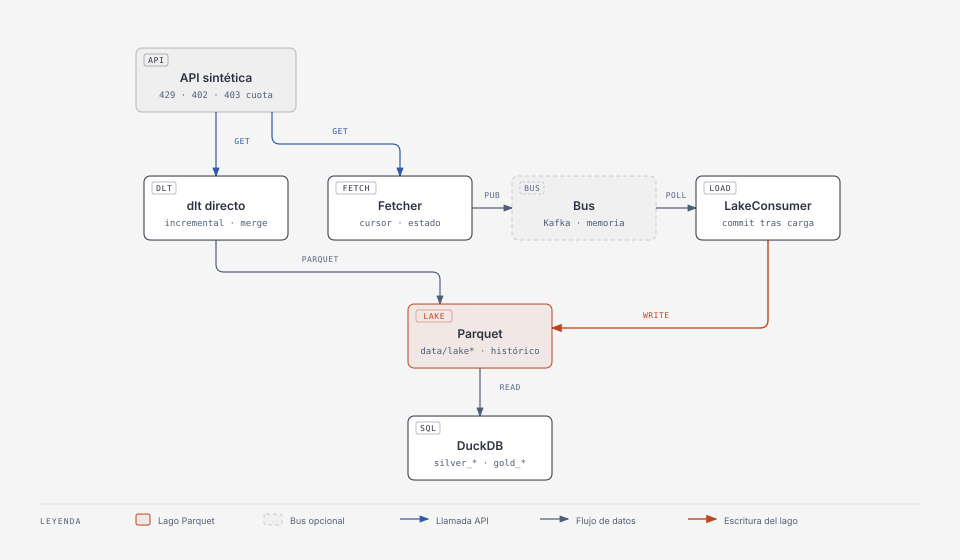

# Prototipo de ingesta de datos: coach de IA para League of Legends

Prototipo funcional de la **capa de ingesta** del proyecto. Usa solo las herramientas propuestas en los apuntes: **dlt** para extraer y cargar, **Apache Kafka** para desacoplar las fuentes de la carga, y **Parquet + DuckDB** para almacenar y consultar. Las fuentes con capa gratuita limitada o de pago se simulan con **APIs sintéticas** desplegables en render.com.

Los datos son inventados (generados con Faker): no vienen de Riot ni de ninguna plataforma real.

## Qué hace



*Diagrama editable en [`docs/architecture.svg`](docs/architecture.svg).*

Hay **dos caminos** para llevar el dato desde la API hasta el lago, y ambos terminan en el mismo sitio:

| | Modo directo | Modo bus |
| --- | --- | --- |
| Comando | `python -m ingestion.run direct` | `produce` + `consume` (o `pipeline`) |
| Quién llama a la API | dlt, dentro del propio pipeline | un `Fetcher` aparte, que solo publica |
| Desacopla fuentes y carga | no: si la carga falla, hay que repetir la extracción | sí: los mensajes esperan en el topic |
| Necesita broker | no | sí, salvo `--bus memory` |
| Para qué sirve | comprobar la ingesta dlt de punta a punta | simular el problema de sincronización |

- **Riot (simulada):** partidas con 10 participantes (lista anidada) y su timeline minuto a minuto. Límite de peticiones por ventana, con revisiones posteriores de algunas partidas.
- **Proveedor de pago (simulado):** partidas profesionales con paginación por cursor y créditos que se agotan.
- **Vídeo (simulada, estilo YouTube/Twitch):** metadatos de vídeos de rangos altos con cuota diaria.
- **Reloj simulado:** `POST /admin/clock/advance?minutes=N` adelanta solo el tiempo interno de la API. Al avanzar, se completan partidas nuevas (su duración simulada es de 20-40 minutos), aparecen partidas profesionales cada 10 minutos y vídeos cada 20; el 5 % de las partidas se revisa dos horas después y la cuota de vídeo se renueva al cambiar el día simulado. No cambia la hora del ordenador.

Cada fuente falla como lo haría la real: la de Riot responde **429 + `Retry-After`** cuando se supera la ventana de peticiones, el proveedor de pago devuelve **402** al agotar los créditos y la de vídeo **403** con cuota diaria. Así se comprueba que la ingesta aguanta los límites en vez de fallar.

## Estructura

```
synthetic_api/   generator.py · main.py (FastAPI con límites) · dashboard.html (panel local)
ingestion/       clients.py · transform.py · sources.py (dlt) · pipeline.py
                 bus.py · producer.py · consumer.py (Kafka) · warehouse.py (DuckDB) · run.py (CLI)
consume_kafka_retry.py  consumidor Kafka con grupo persistente y lago reutilizable
tests/           54 pruebas: API, generador, ingesta directa, almacén, bus y panel
docs/            architecture.svg (el diagrama que se muestra arriba)
scripts/         kafka.py (install/start/stop/status) · kafka.properties · kafka-log4j.properties
.dlt/            config.toml (se sube) · secrets.toml (local, ignorado por Git)
render.yaml · requirements.txt · requirements-api.txt
```

Dentro de `ingestion/`, cada archivo tiene una responsabilidad y se puede leer por separado:

| Archivo | Responsabilidad |
| --- | --- |
| `clients.py` | Peticiones HTTP a las tres fuentes. Reintenta ante 429/5xx y convierte 402/403 en `QuotaExhausted`. |
| `sources.py` | Recursos dlt (cursor incremental + clave primaria + `merge`). |
| `pipeline.py` | Construye el pipeline dlt y ejecuta el modo directo. |
| `producer.py` | `Fetcher`: consulta las APIs respetando sus límites y publica en los topics. |
| `consumer.py` | `LakeConsumer`: lee de los topics y carga con dlt; confirma el offset tras cargar. |
| `bus.py` | Interfaz `MessageBus` + implementaciones en memoria y Kafka. |
| `warehouse.py` | Vistas DuckDB (`silver_*`, `gold_*`) sobre el Parquet. |
| `run.py` | CLI con los cinco comandos. |

## Puesta en marcha

```bash
pip install -r requirements.txt
python -m pytest tests -q                       # la integración Kafka se omite si no hay broker

# 1) API sintética en local
uvicorn synthetic_api.main:app --port 8000

# 2) Ingesta directa con dlt (otra terminal)
python -m ingestion.run direct --max-timelines 20
curl -X POST "localhost:8000/admin/clock/advance?minutes=360" -H "X-Admin-Token: dev-admin"
python -m ingestion.run direct --max-timelines 20     # solo baja lo nuevo y lo revisado

# 3) Modo bus (productor + consumidor) y análisis
python -m ingestion.run pipeline --max-timelines 20   # bus en memoria, sin broker
python -m ingestion.run report                        # benchmarks y comparación de un jugador
```

`--max-timelines` es un **presupuesto**: un timeline cuesta una petición por partida, así que se descargan unos pocos por pasada y el resto queda pendiente para la siguiente.

La ingesta apunta por defecto a la URL de Render que está en `.dlt/config.toml`. Para usar la API local hay que redirigirla, o dlt consultará la remota:

```powershell
$env:SOURCES__API__BASE_URL = "http://127.0.0.1:8000"
$env:SOURCES__API__RIOT_TOKEN = "dev-riot-key"
$env:SOURCES__API__PROVIDER_TOKEN = "dev-provider-key"
$env:SOURCES__API__VIDEO_KEY = "dev-video-key"
```

Si ya tienes un `.dlt/secrets.toml` con las claves de Render, esas variables de entorno hacen falta: el `.toml` tiene prioridad y la API local respondería 401 con claves ajenas.

### Panel visual local y consultas a Render

En PowerShell, habilita el panel antes de arrancar la API:

```powershell
$env:ENABLE_DEV_DASHBOARD = "1"
uvicorn synthetic_api.main:app --host 127.0.0.1 --port 8000
```

Abre `http://127.0.0.1:8000/dev` (o `http://127.0.0.1:8000`, que redirige al panel cuando está habilitado). El selector permite probar la API local o consultar la URL de `.dlt/config.toml` (Render). Para Render, el proceso local lee `sources.api.riot_token`, `sources.api.provider_token` y `sources.api.video_key` de `.dlt/secrets.toml` o del entorno y reenvía solo las rutas de lectura permitidas. Las claves no se envían al navegador ni se guardan en el historial. El botón de estado remoto requiere además `sources.api.admin_token`; avanzar o reiniciar el reloj de Render no está permitido desde el panel.

La sección **Datos de la API en tablas** carga bajo demanda partidas Riot y sus participantes, partidas profesionales y picks, vídeos, o los eventos y la evolución minuto a minuto de un timeline. La tabla Riot muestra el total de partidas visibles, permite elegir entre 10 y 100 filas por página y navegar hasta las más recientes; avanzar o reiniciar el reloj local actualiza la tabla si ya se había cargado. El filtro permite buscar por cualquier columna de las filas cargadas, incluidas las tablas relacionadas de jugadores y picks; es exacto por defecto y también ofrece coincidencia parcial, y trabaja sobre la página actual, no sobre todas las páginas sin cargar. Para facilitar la lectura, muestra `UTILITY` como `SUPPORT` en los valores de rol; la respuesta JSON de la API no se altera. El panel también muestra las respuestas y el historial, y permite ejecutar `pytest`. El historial se guarda solo en memoria y no registra query strings ni credenciales. El panel requiere una conexión local y está desactivado por defecto; no habilites `ENABLE_DEV_DASHBOARD` en Render.

El panel es solo una herramienta de desarrollo: no forma parte de la ingesta y no es necesario para nada de lo anterior.

### Con Kafka real, sin Docker

Kafka era la única pieza que pedía contenedores. Ya no: corre como un proceso Java normal en modo KRaft (sin ZooKeeper).

```powershell
python scripts\kafka.py install            # una sola vez: descarga Kafka 3.7 en la carpeta del usuario
python scripts\kafka.py start              # broker en localhost:9092
$env:KAFKA_BOOTSTRAP = "localhost:9092"
python -m ingestion.run produce --bus kafka --state data/state_kafka --max-timelines 5
python .\consume_kafka_retry.py
python scripts\kafka.py stop               # los datos de data/kafka se conservan
```

En Linux o macOS es el mismo comando con barras normales (`python scripts/kafka.py start`): el script es Python y funciona igual en los tres sistemas. También hay `python scripts/kafka.py status`, y `--port`, `--heap` y `--home` si necesitas cambiarlos.

Necesita **Java 8 o superior** en el PATH (Kafka 3.7 es la última versión que funciona con Java 8). El script invoca la clase `kafka.Kafka` con classpath wildcard porque los lanzadores oficiales estorban aquí: los `.bat` fallan en Windows con «la línea escrita es demasiado larga» (Windows limita la longitud del comando y Kafka trae ~120 JARs) y los `.sh` añaden una capa que no hace falta. Datos del broker en `data/kafka`, consola en `data/kafka.log`.

**Ojo con un Java de 32 bits.** Kafka mapea sus ficheros de log en memoria y un JVM de 32 bits solo tiene ~1,5 GB de espacio de direcciones: en cuanto `data/kafka` crece, el broker muere con `OutOfMemoryError: Map failed` (un mensaje que no explica nada). El script avisa si detecta un Java de 32 bits. Si te pasa, borra `data/kafka` y usa un JDK de 64 bits.

El consumidor reutiliza siempre `data/lake_kafka` y `data/state_kafka`; el grupo `lake-loader-kafka` conserva sus offsets entre ejecuciones. Un grupo **nuevo** empieza a leer desde el principio de los mensajes retenidos, así que su primera ejecución vuelve a añadir filas al lago Parquet: `drain()` espera unos segundos a que el grupo termine de unirse antes de darse por vacío. DuckDB deduplica las vistas `silver_*`; después, el mismo grupo continúa desde los offsets confirmados. Para usar otro grupo: `--group otro-nombre` o `KAFKA_CONSUMER_GROUP`.

**En Render:** subir el repositorio a GitHub y en Render elegir *New > Blueprint* apuntando a `render.yaml`. Copia las claves que genera el panel al archivo local `.dlt/secrets.toml` (no se sube a GitHub) y configura la URL en `.dlt/config.toml` o en `SOURCES__API__BASE_URL`.

**Credenciales:** no hacen falta para ejecutar las pruebas ni la API sintética local; esta usa las claves de desarrollo (`dev-riot-key`, `dev-provider-key` y `dev-video-key`). Para usar la API desplegada en Render sí necesitas sus claves generadas; ahí el `.dlt/secrets.toml` sí es necesario.

## Cómo se construyó (incremental, un paso por test)

El enunciado pedía desarrollar el sistema por pasos para poder revisar el código generado con IA. Cada paso se puede ejecutar y entender antes de pasar al siguiente, y cada uno llega con sus tests como contrato:

| Paso | Qué se añadió | Tests (el contrato) |
| --- | --- | --- |
| 1 | Generador sintético determinista (misma semilla, mismos datos) | `test_generator.py` (8) |
| 2 | API con 429, créditos, cuota y reloj simulado | `test_api.py` (10) |
| 3 | Ingesta directa con dlt (incremental, merge, paginación) | `test_direct_ingestion.py` (8) |
| 4 | Vistas DuckDB sobre Parquet (silver/gold) | `test_warehouse.py` (7) |
| 5 | Bus Kafka: productor, consumidor, commit tras carga | `test_kafka_flow.py` (11) · `test_kafka_integration.py` (1) |
| + | Panel de desarrollo local y su test | `test_dashboard.py` (9) |

Son **54 pruebas**: 53 se ejecutan siempre y la de integración con Kafka necesita un broker real (se omite si no hay). Con `python scripts\kafka.py start` en marcha pasan las 54.

Dos de esos tests nacieron de un fallo encontrado durante el desarrollo, y por eso están señalados en el código:

- `test_drain_waits_for_a_group_that_is_still_rebalancing`: un grupo de consumidores nuevo tarda en unirse y sus primeros `poll()` vuelven vacíos. Sin esperar, `drain()` terminaba «sin mensajes» dejando el topic lleno.
- `test_incremental_does_not_redownload_everything`: no basta con que las filas no se dupliquen —dlt filtraría por su cuenta—; la segunda pasada no debe **volver a pedir** todo. Sin ese test, usar un cursor roto solo se notaba en el tráfico contra la API.

## Decisiones de diseño

- **EL antes que T.** Se carga el dato en bruto y la transformación (dedupe, métricas) se hace después en DuckDB. Así se puede reprocesar sin volver a llamar a la API, que es la parte cara y limitada.
- **Cursor `(updated_at, match_id)`, no `game_creation`.** El ID desempata marcas iguales al reanudar una página y `updated_at` también captura las partidas que la fuente revisa más tarde.
- **El lago conserva el histórico y DuckDB deduplica.** Comprobado: con destino Parquet en disco, dlt degrada `merge` a `append` (lo avisa en el log). Por eso las vistas `silver_*` se quedan con la última versión de cada clave primaria, en vez de confiar en el `merge` del destino.
- **Kafka resuelve la sincronización.** El productor respeta los límites de cada API; el consumidor confirma el offset solo si dlt cargó el lote. Si falla, se reentrega (al menos una vez) y los duplicados se absorben por clave primaria. El commit va *después* de la carga, no antes: es lo que convierte un fallo en un reintento en vez de una pérdida.
- **Timelines con presupuesto.** Cuestan una petición por partida y van más lentos que las partidas; lo pendiente se conserva y se completa en la siguiente pasada.
- **Cuota agotada no es un fallo.** Se carga lo que se pudo y se continúa en la siguiente ejecución sin perder el cursor. Un 402 o un 403 con `quotaExceeded` son condiciones esperadas de la fuente, no errores del pipeline.

## Pruebas y limitaciones

- **Kafka real y el flujo productor-consumidor se probaron localmente.** El test de integración verifica publicación, confirmación y reentrega (`$env:KAFKA_BOOTSTRAP="localhost:9092"; python -m pytest -q tests/test_kafka_integration.py`) contra el broker nativo de `python scripts\kafka.py start`.
- **El API sintético desplegado en Render también se probó.** En el plan gratuito puede dormirse y, al reiniciarse, pierde su estado en memoria. El cursor local puede quedar por delante de los datos reiniciados; comprueba el estado antes de reiniciar la ingesta y no borres `data/` sin decidir primero qué lago o cursor quieres conservar.
- **El destino es el disco local.** Para MinIO/S3 basta cambiar `bucket_url` y las credenciales en `secrets.toml`, como en los apuntes, pero no se ha probado aquí.
- **Los datos sintéticos no tienen valor estadístico real.** Sirven para probar el sistema, no para sacar conclusiones sobre el juego.

## Cómo revisar este código

El enunciado avisa de que el código generado con IA hay que revisarlo y de que los agentes tienden a retocar los tests hasta que pasan. Estas son las reglas con las que se construyó, y cómo comprobarlas.

**Los tests son el contrato.** Si un test falla, se arregla el código, no el test. Durante el desarrollo se modificaron cuatro, siempre con motivo explícito: dos tenían una comprobación débil o equivocada y se sustituyó por otra más estricta (con un oráculo independiente, lo que además destapó un bug real en la API sintética) y otros dos planteaban un escenario que en realidad no llegaba a agotar la cuota ni los créditos, así que no probaban lo que decían probar.

**Un test no vale si no puede fallar.** Es lo que se comprobó con mutaciones: se rompe el código a propósito y se mira si algún test lo detecta.

| Mutación | ¿La detectan los tests? |
| --- | --- |
| `warehouse.py`: las vistas `silver_*` dejan de deduplicar | sí |
| `consumer.py`: se confirma el offset antes de cargar | sí |
| `producer.py`: el cursor no se guarda en disco | sí |
| `sources.py`: se ignora el cursor y se pide desde cero | no al principio |

La última sobrevivió: pedir desde cero no duplica filas porque dlt filtra por su propio estado, así que ningún test notaba el doble de tráfico. Se añadió `test_incremental_does_not_redownload_everything`, que cuenta las peticiones, y ahora también cae. Se puede reproducir el experimento a mano:

```bash
# rompe algo y mira si la suite se entera
python -m pytest tests -q
git checkout -- .    # deshaz el cambio
```

**Lee el código en el orden de los pasos.** Cada paso se ejecuta y se entiende por separado; los tests de cada uno dicen qué contrato cumple. Los pasos 3 y 5 son los que más superficie tienen (respectivamente, la lógica de dlt y la semántica de entrega de Kafka).
